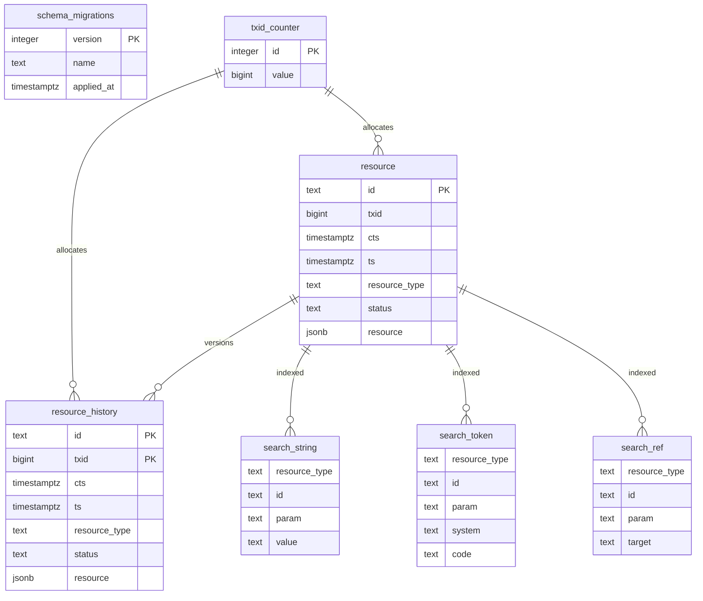
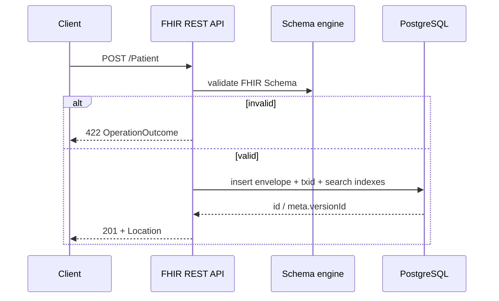

# Architecture

FhirServer is a **FHIR backend**: resources in, resources out, with PostgreSQL persistence and FHIR Schema validation. The pieces below are what you compose when building healthcare apps on top of it.

## Platform components

```
┌─────────────────────────────────────────────────────────────────┐
│                        Clients / apps                           │
│              (EHR UI · SMART apps · integrations)               │
└────────────────────────────┬────────────────────────────────────┘
                             │  application/fhir+json
┌────────────────────────────▼────────────────────────────────────┐
│                      FHIR REST API                              │
│     CRUD · Search · History · Bundle · Operations · Bulk        │
├──────────────┬──────────────┬──────────────┬────────────────────┤
│  Validation  │ Terminology  │ Access       │ Subscriptions      │
│  FHIR Schema │ $expand /    │ SMART scopes │ rest-hook          │
│  + profiles  │ $lookup /    │ Basic · BALP │ /_hooks sink       │
│              │ $validate-   │ audit        │                    │
│              │ code         │              │                    │
├──────────────┴──────────────┴──────────────┴────────────────────┤
│                 PostgreSQL                                      │
│   JSONB envelopes (current + history) · search_* indexes · txid │
└─────────────────────────────────────────────────────────────────┘
```

| Component | Role |
|-----------|------|
| **FHIR REST API** | Standard interactions and `$` operations; `CapabilityStatement` from the generated catalog |
| **Validation** | Writes and `$validate` run through FHIR Schema (no Firely at runtime) |
| **Terminology** | Expand / lookup / validate-code against stored `ValueSet` and `CodeSystem` |
| **Access control** | SMART discovery + tokens; HTTP Basic; optional organization (tenant) isolation via RLS |
| **Subscriptions** | Rest-hook notifications when matching resources change |
| **PostgreSQL** | Source of truth: envelope JSON + version history + SQL search indexes |

Offline codegen ([`Generator/`](../Generator/README.md)) turns `hl7.fhir.r5.core` into embedded schemas, search catalog, and validator source under `Packages/`.

## FHIR & FhirServer

- **Version:** **FHIR R5 only** today (`hl7.fhir.r5.core@5.0.0`). See [FhirVersion.md](FhirVersion.md) before introducing R4 or other releases.
- **Wire format:** `application/fhir+json` (XML is not a first-class format yet).
- **Storage:** FHIR JSON in PostgreSQL `jsonb` envelopes—not a fully relational column-per-element model.
- **Validation:** FHIR Schema generated from StructureDefinition snapshots (plus a FHIRPath constraint subset and core constraint profiles).
- **Search:** Parameter definitions from R5 `SearchParameter` resources; runtime filters use SQL side indexes maintained on write.

Everything clients care about is a **resource**. Resource types drive tables, REST routes, search parameters, and validation schemas.

## Database

Resources are stored as **envelopes**:

- One **current** table per resource type (e.g. `patient`)
- One **history** table (e.g. `patient_history`) with PK `(id, txid)`
- Global `txid_counter` → FHIR `meta.versionId` / ETag
- Body column holds JSON (`jsonb`); the HTTP codec owns id / meta / resourceType on the wire
- Search side tables (`search_string`, `search_token`, `search_ref`, `search_date`, `search_quantity`) updated on upsert/delete; `_lastUpdated` uses envelope `ts`



Migrations run on startup. Optional **organization / tenant** isolation uses Postgres RLS (`app.tenant_id`) when SMART clients carry `OrganizationId` — see [Features.md](Features.md) and [Configuration.md](Configuration.md).

## Validation pipeline

1. Official package `hl7.fhir.r5.core` (via [`Generator/`](../Generator/README.md))
2. StructureDefinition snapshot → nested IR → `*.schema.json` + valuesets (+ profile schemas)
3. `make sync-schemas` copies artifacts into `Packages/`
4. At runtime, create/update and `$validate` call the schema engine
5. Writes return **422** on schema failure; `$validate` returns an `OperationOutcome` (HTTP 200)

When `meta.profile` references a loaded core constraint profile, that profile schema is applied as well. Extra Implementation Guides need generating/syncing additional packages.

## Request flow (create)



## Code map (for contributors)

| Area | Location | Responsibility |
|------|----------|----------------|
| Hosting & routes | `Program.fs`, `AppHost.fs` | DI, HTTP surface |
| HTTP / capability / auth | `Infrastructure/Http`, Smart, Audit middleware | Wire format, discovery, scopes |
| Resource use cases | `Application/` | create, read, search, Bundle, ops |
| FHIR domain logic | `Domain/` | catalog, search planning, store contract, validation facade |
| Persistence | `Infrastructure/Persistence` | Envelope store, SQL dialect, migrations, search SQL |
| Schemas & validator | `Packages/` | Embedded R5 artifacts + `SchemaEngine` |
| Codegen | `Generator/` | HL7 package → schemas + F# sources |

Prefer extending behavior once in the resource handlers / envelope store rather than duplicating logic per endpoint. API surface checklist: [Features.md](Features.md).

## Design choices

- **FHIR-first wire contract** — clients speak standard REST + JSON; internals stay replaceable
- **One envelope model** — shared store implementation; PostgreSQL owns durability
- **Generate from HL7 packages** — avoid hand-maintaining hundreds of resource shapes
- **Firely-free runtime** — validation story owned in-repo via FHIR Schema
