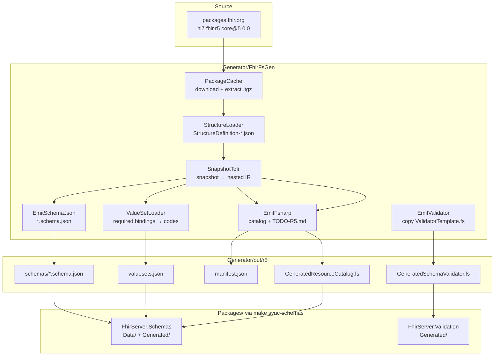
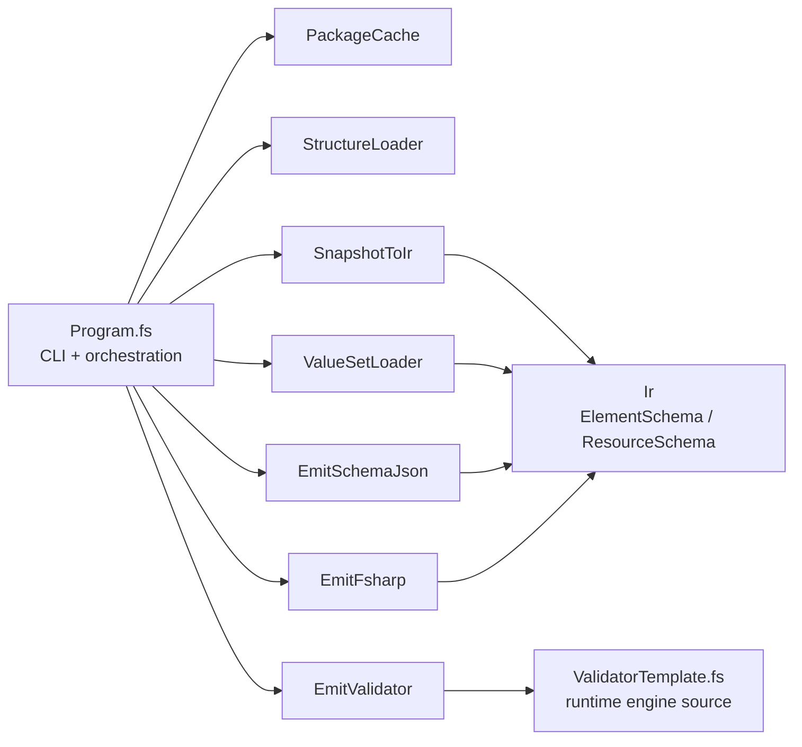
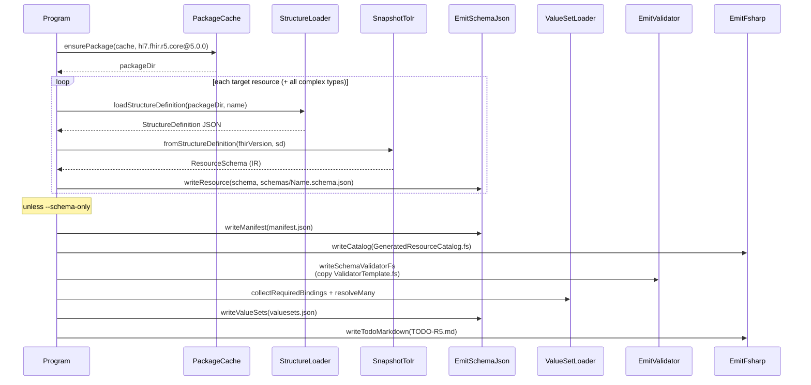
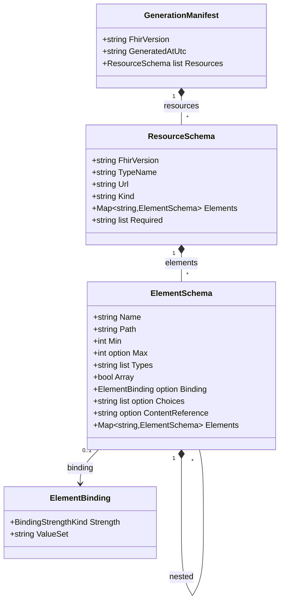
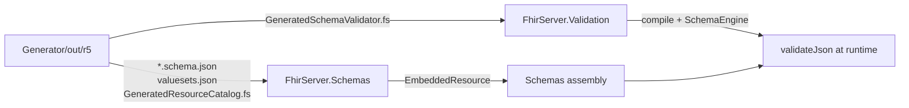

# FHIR F# Generator (R5)

Generates **FHIR Schema JSON** + **Firely-free** `GeneratedSchemaValidator.fs` from official `hl7.fhir.r5.core@5.0.0` package JSON ([packages.fhir.org](https://packages.fhir.org)).

Resource index: [hl7.org/fhir/resourcelist.html](https://hl7.org/fhir/resourcelist.html) (R5 / v5.0.0).

> **No Firely / `Hl7.Fhir.*` in this generator.** StructureDefinitions are plain JSON from the NPM package.

## Validation strategy

| Concern | Who owns it |
|---------|-------------|
| Structure, cardinality, arrays, choices `[x]`, primitives (incl. date/dateTime/instant/uri/…), required bindings, complex datatypes, `contentReference`, ele-1, `meta.profile` format | **`FhirServer.Validation`** + schemas from **`FhirServer.Schemas`** |
| `$validate` / write 422 | FhirServer `ResourceValidator` → `SchemaEngine.validateJson` |
| Core constraint profiles (`derivation=constraint`) + FHIRPath constraint subset | Generator emits `schemas/profiles/` + `profiles-index.json`; validator applies when `meta.profile` matches |
| Extra / custom IGs beyond `hl7.fhir.r5.core` | Generate from additional packages, then `make sync-schemas` |
| This generator | Package → IR → resource + complex-type + **profile** schemas + valuesets + validator source |

## Layout

```
Generator/
  README.md
  TODO-R5.md
  FhirFsGen/
  cache/                  # hl7.fhir.r5.core (gitignored)
  out/r5/
    schemas/*.schema.json
    schemas/profiles/*.schema.json
    profiles-index.json
    valuesets.json
    manifest.json
    GeneratedResourceCatalog.fs
    GeneratedSchemaValidator.fs

Packages/
  FhirServer.Schemas/     # embedded *.schema.json + profiles + valuesets + catalog
  FhirServer.Validation/  # GeneratedSchemaValidator + SchemaEngine
```

---

## How generation works (UML)

### End-to-end activity



### Module dependencies (components)



### Per-resource sequence



### IR shape (class diagram)



### Sync into packages



Runtime details: see [`Packages/FhirServer.Validation/README.md`](../Packages/FhirServer.Validation/README.md).

---

## Pipeline (short)

```
packages.fhir.org / hl7.fhir.r5.core@5.0.0
  → StructureDefinition snapshot (JSON)
  → IR
  → schemas/<Resource>.schema.json          # 158 resources
  → schemas/<DataType>.schema.json          # 42 complex types (HumanName, …)
  → valuesets.json                          # required bindings (resources + datatypes)
  → GeneratedSchemaValidator.fs             # from ValidatorTemplate.fs
  → GeneratedResourceCatalog.fs             # resources only
  → GeneratedSearchCatalog.fs               # Supported SearchParameter extractors

make sync-schemas / generate*:
  → Packages/FhirServer.Schemas/Data + Generated/
  → Packages/FhirServer.Validation/Generated/
```

## Usage

```bash
make generate          # Patient (+ sync into Packages/)
make generate-r5-all   # all 158 resources + sync
make sync-schemas      # copy out/r5 → Packages/ without regenerating
make generate-todo     # refresh TODO from schemas on disk

dotnet run --project Generator/FhirFsGen -- --resource Patient --out Generator/out/r5
dotnet run --project Generator/FhirFsGen -- --all --out Generator/out/r5
dotnet run --project Generator/FhirFsGen -- --schema-only --resource Observation
dotnet run --project Generator/FhirFsGen -- --search-catalog --out Generator/out/r5
```

## Schema shape

FHIR Schema nesting:

- `elements`, `array`, `required`, `binding`
- `choices` — JSON field names for `[x]` (e.g. `valueQuantity`, `valueString`)
