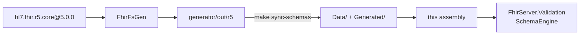

# FhirServer.Schemas

Embedded FHIR R5 schema JSON, required value-set codes, and the generated resource catalog. Consumed at runtime by **`FhirServer.Validation`**.

> Do not edit `Data/*.schema.json`, `Data/valuesets.json`, or `Generated/GeneratedResourceCatalog.fs` by hand. Regenerate with the generator and run `make sync-schemas`.

## Layout

```
FhirServer.Schemas/
  Data/*.schema.json                 # one schema per resource + complex type
  Data/valuesets.json                # url → codes for required bindings
  Generated/GeneratedResourceCatalog.fs
  SchemaPackage.fs                   # assembly marker for embedded resources
  FhirServer.Schemas.fsproj
```

Schemas are embedded with `LogicalName = filename` so the validator can load `Patient.schema.json` / `valuesets.json` by name.

## How they are generated



Details and IR UML: [`generator/README.md`](../../generator/README.md).  
Runtime load path: [`../FhirServer.Validation/README.md`](../FhirServer.Validation/README.md).

## Refresh

```bash
make generate          # Patient (+ sync)
make generate-r5-all   # all R5 resources (+ sync)
make sync-schemas      # copy generator/out/r5 → packages/ only
```

## Public API

```fsharp
open FhirServer.Schemas

// Assembly that embeds schema JSON (used by SchemaEngine)
let asm = SchemaPackage.assembly
```

The catalog (`GeneratedResourceCatalog`) lists supported resource types for `/metadata` and type checks.
