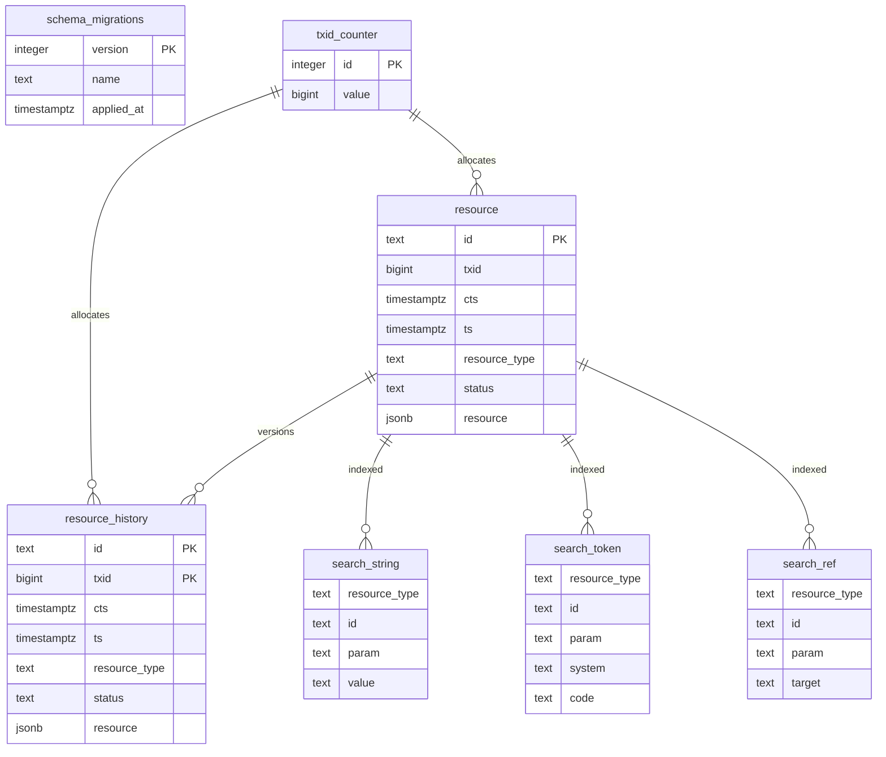
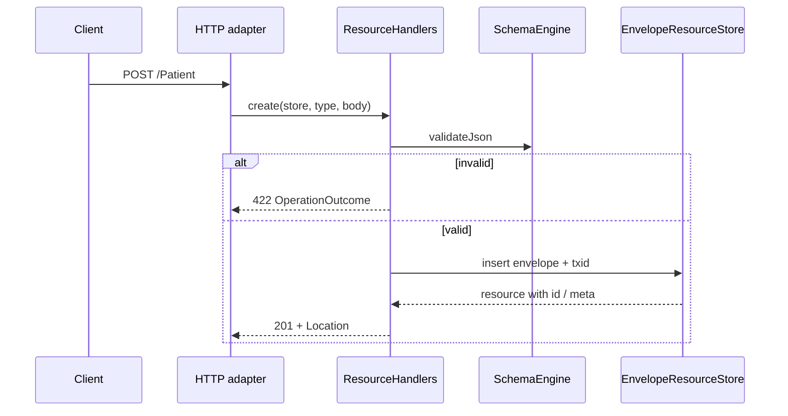

# Architecture

FhirServer uses a hexagonal / DDD-style layout so HTTP, persistence, and validation stay replaceable.

## Layers

```
┌─────────────────────────────────────────────────────────┐
│  Hosting          Program.fs · AppHost.fs (DI, routes)  │
├─────────────────────────────────────────────────────────┤
│  Infrastructure   HTTP · Capability · Persistence       │
├─────────────────────────────────────────────────────────┤
│  Application      ResourceHandlers · Audit recorder     │
├─────────────────────────────────────────────────────────┤
│  Domain           Types · Search · Validator · Ports    │
└─────────────────────────────────────────────────────────┘
         │                              │
         ▼                              ▼
   FhirServer.Validation         IResourceStore
   FhirServer.Schemas            EnvelopeResourceStore
                                 + SQL dialect (Postgres)
```

| Area | Responsibility |
|------|----------------|
| **Domain** | FHIR resource JSON model helpers, catalog, search logic, `IResourceStore` port, validation facade |
| **Application** | Use cases (`create`, `read`, `search`, Bundle, …) and BALP audit event building |
| **Infrastructure** | ASP.NET endpoints, auth, audit middleware, SQL persistence + migrations |
| **Packages** | Embedded `*.schema.json`, valuesets, generated catalog and schema validator |
| **Generator** | Offline tool: HL7 package → IR → schemas + F# validator source |

## Persistence model

Resources are stored as **envelopes**, not as fully relational FHIR element columns:

- One **current** table per resource type (e.g. `patient`)
- One **history** table (e.g. `patient_history`) with PK `(id, txid)`
- Global `txid_counter` → FHIR `meta.versionId` / ETag
- Body column holds JSON (`jsonb`), omitting duplicated id / meta / resourceType where the codec owns those fields

`EnvelopeResourceStore` implements `IResourceStore` once. `IEnvelopeDialect` / `IEnvelopeSession` supply SQL access (`SqlEnvelopeDialect` / Postgres). Migrations use `MigrationRunner` + `SqlMigrations`.

Search uses side index tables maintained on upsert/delete (`search_string`, `search_token`, `search_ref`) plus envelope `ts` for `_lastUpdated`. `SearchEngine.toSearchPlan` builds the filter; `SearchCurrent` runs parameterized SQL with paging and total count.



## Validation pipeline

1. Official package `hl7.fhir.r5.core` (via [`generator/`](../generator/README.md))
2. StructureDefinition snapshot → nested IR → `*.schema.json` + valuesets
3. `make sync-schemas` copies artifacts into `packages/`
4. At runtime, `ResourceValidator` → `SchemaEngine.validateJson`
5. Writes return **422** on schema failure; `$validate` returns an `OperationOutcome` (HTTP 200)

Core R5 constraint profiles and FHIRPath constraint subset are emitted by the generator and applied at validate/write when `meta.profile` references a loaded profile. Additional IGs require generating/syncing extra profile schemas.

## Request flow (create)



## Design principles

- Prefer **small modules and explicit ports** over a large framework surface
- Keep **one store implementation**; the SQL dialect owns persistence
- Generate **schemas from HL7 packages** instead of hand-maintaining hundreds of resource shapes
- Stay **Firely-free** at runtime so the validation story is owned in-repo
