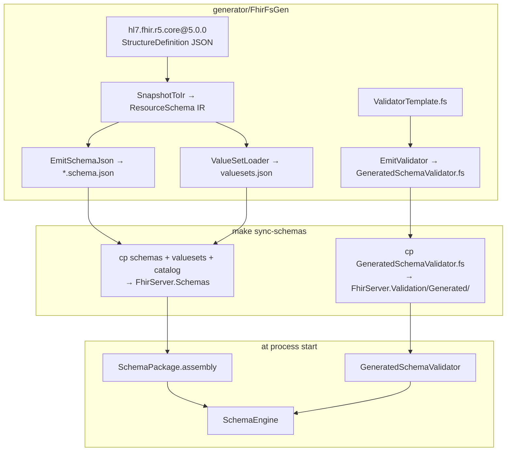
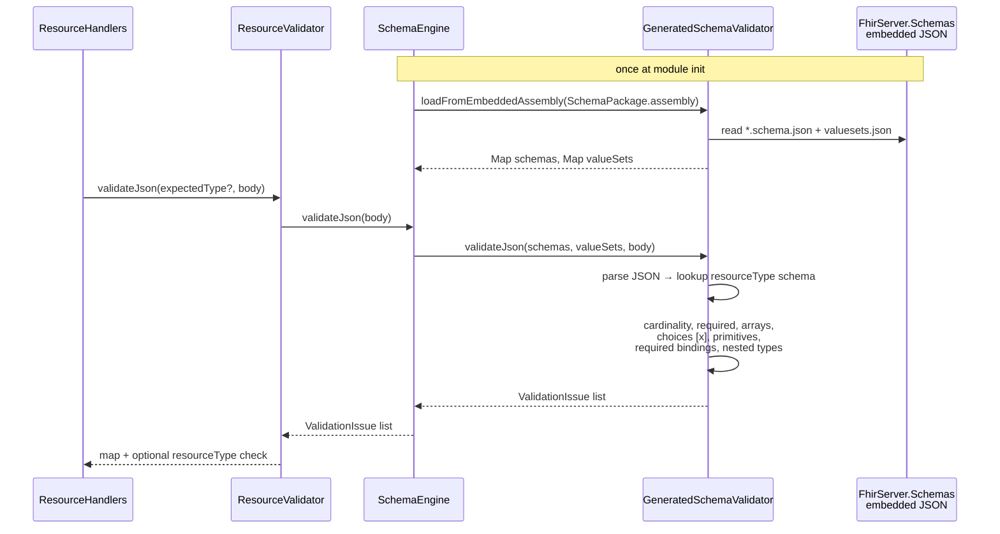
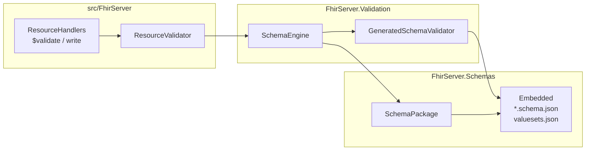

# FhirServer.Validation

Firely-free FHIR Schema validator. Compiles the generated engine and loads R5 schemas / value sets from **`FhirServer.Schemas`**.

> Source of truth for schemas and the validator template: [`generator/`](../../generator/README.md). Do not edit `Generated/GeneratedSchemaValidator.fs` by hand — regenerate + `make sync-schemas`.

## Layout

```
FhirServer.Validation/
  SchemaEngine.fs                         # thin entry: load + validateJson
  Generated/GeneratedSchemaValidator.fs   # copied from generator/out/r5
  FhirServer.Validation.fsproj

FhirServer.Schemas/                       # sibling package
  Data/*.schema.json                      # embedded resources
  Data/valuesets.json
  Generated/GeneratedResourceCatalog.fs
  SchemaPackage.fs                        # assembly marker
```

## How artifacts are generated (UML)

The validator package does **not** run the generator. It **consumes** outputs produced by `FhirFsGen` and synced by Make.



Full generation sequence and IR class diagram: [`generator/README.md`](../../generator/README.md#how-generation-works-uml).

### What each emit step produces

| Generator step | Output | Landed in |
|----------------|--------|-----------|
| `EmitSchemaJson.writeResource` | `schemas/<Type>.schema.json` | `FhirServer.Schemas/Data/` |
| `EmitSchemaJson.writeValueSets` | `valuesets.json` | `FhirServer.Schemas/Data/` |
| `EmitFsharp.writeCatalog` | `GeneratedResourceCatalog.fs` | `FhirServer.Schemas/Generated/` |
| `EmitValidator.writeSchemaValidatorFs` | copy of `ValidatorTemplate.fs` | `Generated/GeneratedSchemaValidator.fs` |

`EmitValidator` does not codegen logic from IR — it ships the shared engine template. Schemas drive behaviour at runtime.

## Runtime validation (UML)



### Component view



## Refresh

```bash
make generate          # Patient (+ sync)
make generate-r5-all   # all R5 resources (+ sync)
make sync-schemas      # copy generator/out/r5 → packages/ only
```

## Public API

```fsharp
open FhirServer.Validation

// Empty list = valid
let issues = SchemaEngine.validateJson fhirJsonBody
```

Server facade: `FhirServer.Domain.Services.ResourceValidator` (maps issues → `OperationOutcome`, checks path `resourceType`).
